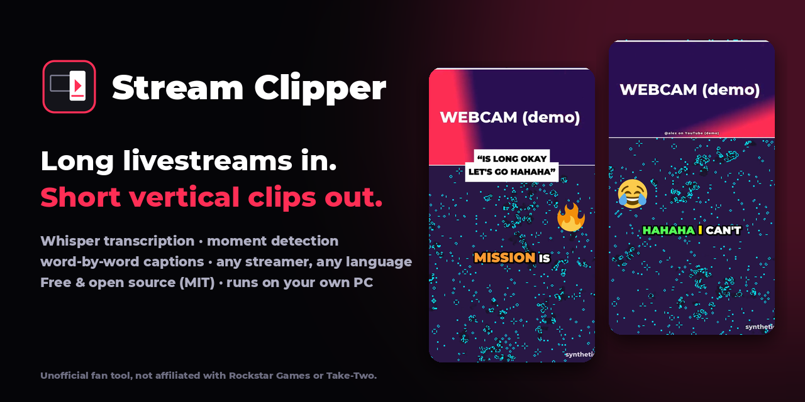
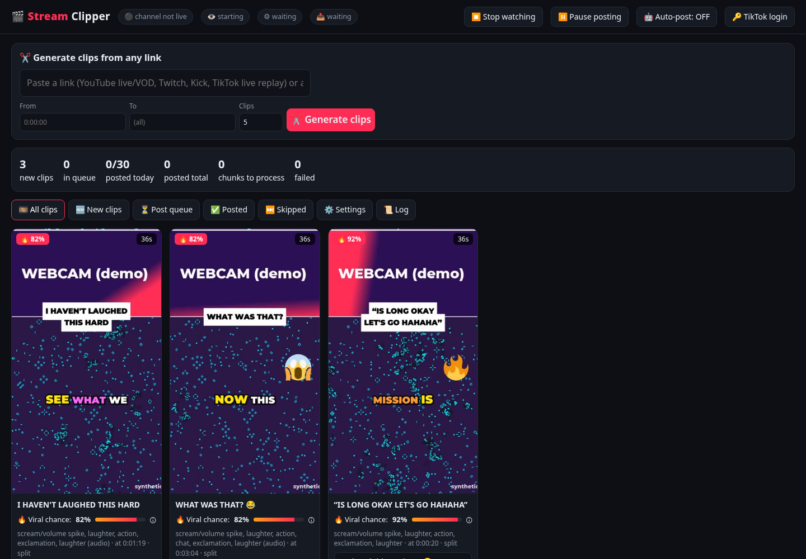
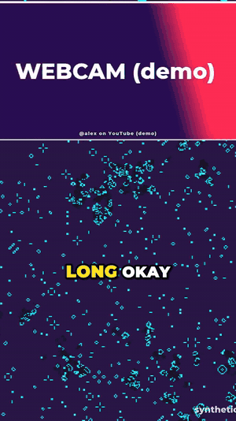
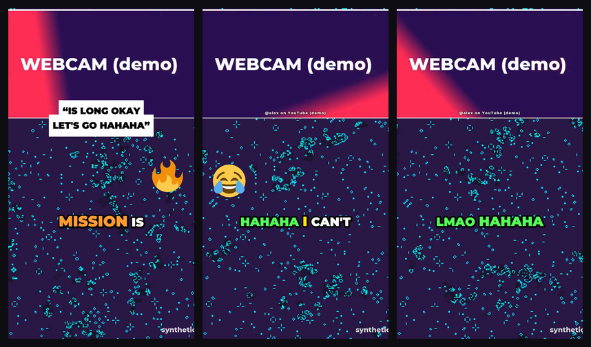
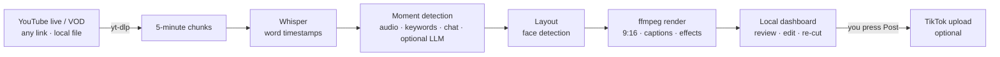
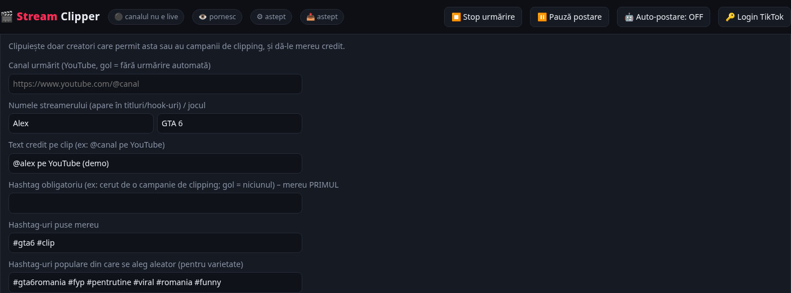

<p align="center"></p>

<h1 align="center"><a href="https://github.com/LucianCeusanRo/stream-clipper/releases/latest/download/StreamClipper-Setup.exe">⬇️ Download for Windows</a></h1>
<p align="center"><b>Installer: Next → Next → Install.</b> Free. Windows asks for administrator once (UAC) during install; after that the app starts with admin rights without any prompt. <a href="https://github.com/LucianCeusanRo/stream-clipper/releases/latest">All downloads</a> · Windows 10/11 · unsigned, so SmartScreen may ask: <i>More info → Run anyway</i>.</p>

<p align="center">
<a href="https://github.com/LucianCeusanRo/stream-clipper/actions/workflows/ci.yml"></a>
<a href="LICENSE"></a>


<a href="https://github.com/LucianCeusanRo/stream-clipper/releases"></a>
<a href="https://github.com/LucianCeusanRo/stream-clipper/stargazers"></a>
</p>

<p align="center">
<b>Clip GTA 6 streams into Shorts and TikToks automatically, with word-by-word captions.</b><br>
Built for GTA 6, but it works for any streamer, game or language.<br>
<a href="https://lucianceusanro.github.io/stream-clipper/">Website</a> ·
<a href="#quick-start">Quick start</a> ·
<a href="https://github.com/LucianCeusanRo/stream-clipper/releases/latest/download/StreamClipper-Setup.exe">Download</a> ·
<a href="https://github.com/LucianCeusanRo/stream-clipper/discussions/1">💬 The debate: is clipping streamers free promotion or taking their work?</a> ·
<a href="README.ro.md">Română</a>
</p>

> [!NOTE]
> **Unofficial fan tool, not affiliated with Rockstar Games or Take-Two.** No game footage, logos or trademarks are included in this repository. All images here come from a synthetic test video generated with ffmpeg.

<p align="center"></p>

## Table of contents

- [What it is](#what-it-is)
- [Respect creators](#respect-creators)
- [Features](#features)
- [Demo](#demo)
- [How it works](#how-it-works)
- [Quick start](#quick-start)
- [Usage](#usage)
- [Configuration reference](#configuration-reference)
- [Requirements](#requirements)
- [FAQ](#faq)
- [Limitations](#limitations)
- [Roadmap](#roadmap)
- [Contributing](#contributing)
- [Credits and license](#credits-and-license)

## What it is

Stream Clipper is a Windows desktop app that **watches a YouTube channel, records the live from the start, transcribes it with Whisper, finds the loud, funny or intense moments, and renders 9:16 clips (20–60 s)** with big captions that highlight each word as it's spoken. It also takes any link yt-dlp supports (YouTube, Twitch, Kick VODs…) or a video file from your PC.

Everything runs on your own computer. You review every clip in a local dashboard and decide what gets posted.

**Who it's for:** people who make clips *for creators who want them*: a streamer's own editor, a fan page with permission, or someone in an official clipping campaign.

**Honest background:** I'm a beginner learning programming. I built this with **AI-assisted coding**, then tested and fixed it by actually running it. It works on my PC; it's not a polished commercial product. Bug reports and pull requests are very welcome.

## Respect creators

Clips are someone else's work. Please:

- clip only creators who **allow it** or run a **clipping campaign** (many streamers do, with rules and a required hashtag: that's what `required_hashtag` is for);
- always **credit the creator** (`credit_text` burns e.g. "@channel on YouTube" into every clip);
- follow YouTube, Twitch, Kick and TikTok rules, and take a clip down if the creator asks.

**Auto-posting is off by default.** Nothing is posted until you press **Post** on a clip.

## Features

- 🔴 **Live watching**: checks a channel every minute, records new lives *from the beginning* (DVR), fills gaps after disconnects, and keeps cutting clips while the stream runs.
- 📡 **Kick & Twitch channels on autopilot**: add channels under **Channels**; each one is checked every 90 s (also from the tray), recorded when it goes live, stopped when the live ends and turned into clips. Offline channels idle quietly; errors and rate limits back off.
- 🔗 **Any link or file**: YouTube live/VOD, Twitch, Kick, TikTok live replays (anything yt-dlp supports) or a local `.mp4`, with an optional from/to range.
- 🗣️ **Whisper transcription**: faster-whisper with word timestamps (`small` int8 by default, `large-v3-turbo` on an NVIDIA GPU, low-memory mode for weaker PCs); set the language (`en`, `ro`, `es`, …) or `auto`. Extra clean-up for Romanian (diacritics).
- 🎯 **Moment detection**: loudness spikes, screams, laughter rhythm, keywords in English and Romanian (plus your own `extra_keywords`), live chat activity. Optional LLM judge with any OpenAI-compatible API or a free local Ollama model.
- 🧑‍💻 **Smart layout**: face detection finds the webcam: cam on top + game below; no webcam → whole frame over a blurred background.
- 💬 **Captions that pop**: 1–3 word groups, the current word highlighted, keyword colours, a hook line only when the streamer really shouted something (their own words, never a game name), 6 bundled fonts.
- ✨ **Effects** (each can be turned off): emoji pop-ups, punch-in zoom on peaks, light shake on rage, original sound effects, loudness normalised to −14 LUFS.
- ✂️ **Review and edit**: viral-chance estimate with the reasons, editable title/description, "New text" button, re-cut ±1 s snapped to sentence edges.
- 📤 **Optional posting, off by default**: TikTok (TikTok Studio website, your own login), YouTube Shorts (official API) and Facebook Reels (export only). Nothing posts unless you press Post or turn on Auto-post. **Rotate** spreads queued clips over your accounts in turn, with each account's daily cap and minutes between posts, never the same clip twice on one account; the planned schedule is shown in **Queue**.
- 🖼️ **Cover frames**: the cover is the payoff moment by default; pick any other frame in the player.
- 💾 **Crash-safe**: state in SQLite, so after a restart or power cut nothing is cut or posted twice.
- 🌍 **English or Romanian dashboard** (`ui_language`).

## Demo

<table>
<tr>
<td width="34%"></td>
<td></td>
</tr>
<tr>
<td colspan="2" align="center"><sub>From the built-in demo: a test video generated with ffmpeg (Conway's Game of Life as "gameplay", a labelled box as "webcam", beeps as "screams") and a scripted transcript. Run it yourself with <code>python tools/demo.py</code>, no GPU or stream needed.</sub></td>
</tr>
</table>

## How it works



## Quick start for testers

1. **[Download `StreamClipper-Setup.exe`](https://github.com/LucianCeusanRo/stream-clipper/releases/latest/download/StreamClipper-Setup.exe)**, run it, say **Yes** to the admin prompt, then **Next → Next → Install** (15–20 min the first time).
2. Open **Stream Clipper** from the Start menu or desktop.
3. Go to **Channels**, paste a Kick channel, e.g. `kick.com/tallsilvr`, press **Add channel**. When the streamer goes live it records by itself.
4. Or test right away: paste a Kick video link (e.g. `https://kick.com/tallsilvr/videos/…`) at the top of **Home**, choose 3 clips, press **Generate**.
5. Open **Clips**, watch them, pick a cover (🖼 in the player) and press **📤 Post** only on the ones you like. Auto-post stays OFF unless you turn it on.

## Quick start

1. **[Download the installer](https://github.com/LucianCeusanRo/stream-clipper/releases/latest/download/StreamClipper-Setup.exe)** (`StreamClipper-Setup.exe`) and run it: **Next → Next → Install**.
2. It sets up Python 3.12 (only if missing), ffmpeg, Deno, the packages and the Whisper model (15–20 minutes the first time) and adds a **Stream Clipper** shortcut. It runs as administrator (some PCs block parts of the setup otherwise, e.g. long file paths) and registers a "Stream Clipper" scheduled task with highest privileges, so the shortcut starts the app elevated **without a UAC prompt over your game**. Put an empty `no-admin.txt` next to `Stream Clipper.exe` to run without admin. Updates install themselves at every start.
   *Prefer manual?* Take the source ZIP from the [release](https://github.com/LucianCeusanRo/stream-clipper/releases/latest), unzip it and double-click `setup.bat`.
3. **Open Stream Clipper**, go to **⚙️ Settings**, set the speech language, channel (optional), streamer name, credit text and hashtags. The game is detected from the stream (Twitch / Kick / YouTube category) and used in titles and hashtags only; captions on the video are just the words the streamer says, and press **Save**.

<details>
<summary><b>Run from source (Linux/macOS/Windows, for developers)</b></summary>

```bash
git clone https://github.com/LucianCeusanRo/stream-clipper.git && cd stream-clipper
python -m venv .venv && . .venv/bin/activate        # Windows: .venv\Scripts\activate
pip install -r requirements.txt                     # also needs ffmpeg on PATH
cp config.example.yaml config.yaml
python -m streamclip selftest --quick               # tests in a temp folder
python -m streamclip run                            # dashboard at http://127.0.0.1:8777
```
The desktop window and the installer are Windows-only; the engine and dashboard also run on Linux (that's how CI tests it).
</details>

## Usage

| I want to… | Do this |
|---|---|
| Clip a channel while it's live | Settings → channel URL → **▶ Start watching** |
| Clip a past stream / VOD | Paste the link at the top, optional From/To (e.g. `1:05:00`–`1:30:00`), number of clips → **✂️ Generate clips** |
| Clip a video on my PC | Paste the path, e.g. `C:\Videos\stream.mp4` → **✂️ Generate clips** |
| Fix a clip | **🔄 New text** for a new title/hashtags, **✂️ Re-cut** to move start/end by ±1 s |
| Post | **📤 Post** (one at a time, with a gap) after **🔑 TikTok login** once |
| Try it without a stream | `python tools/demo.py` → http://127.0.0.1:8833 |

Clip files are saved in `data\clips\`. Your login session stays in `data\tiktok_profile` on your PC.

<p align="center"></p>

### Optional: LLM for better picks and titles

Copy `.env.example` to `.env` and fill in **one** provider (OpenAI, xAI, Groq, OpenRouter) or point it at a local [Ollama](https://ollama.com) model for free. Without an LLM the app uses rules and title templates. Never commit your `.env`.

## Configuration reference

Everything is in `config.yaml` (created from [`config.example.yaml`](config.example.yaml), which documents every key). The most used ones are also in the Settings tab.

| Key | Default | What it does |
|---|---|---|
| `language` | `en` | Whisper speech language (`en`, `ro`, `es`, `de`, … or `auto`) |
| `ui_language` | `en` | Dashboard language: `en` or `ro` |
| `channel_url` | empty | YouTube channel to watch; empty = only links/files you add |
| `streamer_name` / `game` | empty / empty | Used in titles. `game` is only a fallback: the real game is detected from the stream (Twitch / Kick / YouTube category, official name via Steam) and goes into titles and hashtags only (e.g. `#CS2`); unknown = `#gaming #clips`. You can also set it per clip. |
| `credit_text` | empty | Burned into every clip, e.g. `@channel on YouTube` |
| `required_hashtag` | empty | Campaign hashtag, always first when set |
| `hashtags` / `extra_hashtags` / `hashtags_max` | empty / `#gaming #clips #streamer` / 5 | Fixed + randomly picked hashtags (the game's own tag, e.g. `#TheFinals`, is added automatically) |
| `extra_keywords` | `[]` | Your own words that mark a good moment |
| `whisper_model` / `whisper_compute_type` | `auto` / `auto` | auto = `small` int8 (`base` under 8 GB RAM in low mode); `large-v3-turbo` int8_float16 on an NVIDIA GPU |
| `memory_mode` / `ram_cap_gb` / `model_idle_unload_minutes` | `auto` / 0 / 10 | Low-memory mode (auto under 12 GB RAM), optional RAM cap, free the speech model when idle |
| `channel_check_every_sec` | 90 | How often each Kick/Twitch channel under **Channels** is checked |
| `clip_min_sec` / `clip_max_sec` | 15 / 45 | Clip length range |
| `min_score` / `clips_per_chunk_max` | 0.9 / 3 | Lower threshold = more clips |
| `layout` | `split` | `split` (cam + game), `blur`, `fill` |
| `auto_post` | `false` | `true` posts the best clips by itself (only for creators who allow it) |
| `daily_post_cap` / post intervals | 45 / 20–30 min | Global posting pace (each account also has its own cap and gap) |
| `rotate` / `rotate_accounts` | `true` / all | Clips without a chosen account take turns over your accounts |
| `live_title_filter` | empty | Regex: only clip lives whose title matches |

## Requirements

- **Windows 10/11** for the desktop app and installer.
- **8 GB RAM** is enough in low-memory mode (measured peak ~0.7 GB with `base`, ~1.5 GB with `small`; ~0.2 GB when idle). An NVIDIA GPU makes it much faster; without one it runs on the CPU (about 3–4× faster than real time on a modern 8-thread CPU with `small`).
- **~10 GB free disk** (Whisper model ~3 GB, recordings, clips) and internet for downloads.

## FAQ

<details><summary><b>Is it legal to clip streamers?</b></summary>
It depends on the creator and the platform. Many streamers welcome clips or run paid clipping campaigns; others don't. This tool doesn't decide that for you. Clip only creators who allow it, credit them, and remove a clip if asked. This is not legal advice.
</details>

<details><summary><b>Does it work for languages other than English and Romanian?</b></summary>
Transcription and audio-based detection (screams, laughter, volume spikes, chat) work for any language Whisper supports. The built-in keyword list and title templates are English and Romanian; for other languages add your words in <code>extra_keywords</code>, or use an LLM, which writes titles in the language of the transcript.
</details>

<details><summary><b>Does it only work for GTA 6?</b></summary>
No. GTA 6 is the reason I built it, but the app detects the real game of each stream (CS2, Call of Duty, Skate 3, anything) for titles and hashtags, and never puts a game name on the video. For IRL or podcasts without a fixed webcam, the <code>blur</code> or <code>fill</code> layout usually looks better.
</details>

<details><summary><b>Can I use it without a GPU?</b></summary>
Yes, with <code>whisper_model: small</code> or <code>medium</code>. It's slower, so it's better for VODs than for keeping up with a live stream.
</details>

<details><summary><b>Does it upload my videos anywhere?</b></summary>
No. Everything is processed on your PC. Only if you configure an LLM is the transcript text of a candidate moment sent to that provider (or kept local with Ollama). Posting happens only when you press Post.
</details>

<details><summary><b>How is it different from OpenShorts, AI-Youtube-Shorts-Generator or OpusClip?</b></summary>
Those are bigger, more mature projects (or paid services) focused on podcasts and uploaded videos. Stream Clipper is small and focused on one job: watching a live channel and catching moments while the stream is still running, on a Windows gaming PC. If you need more features, they are great options.
</details>

<details><summary><b>YouTube says "Sign in to confirm you're not a bot".</b></summary>
Set <code>youtube_cookies_from_browser: "firefox"</code> (or <code>edge</code>/<code>chrome</code>, the browser you're logged into YouTube with; Chrome must be closed). Never share or commit cookie files.
</details>

## Limitations

- **TikTok posting uses the website**, not an official API. When TikTok changes its upload page, posting breaks until the selectors are updated. It was tested on a test page, not at scale on real TikTok.
- How much of a live can be fetched from the start (DVR) depends on YouTube.
- Detection is rule-based. It finds loud moments well; "funny" is harder. Review clips before posting.
- Whisper still makes mistakes with noise, music, or people talking over each other.
- Some status and error messages and the log are still in Romanian.
- Face detection is simple (a face that stays in one place). Unusual layouts may need a manual `cam_box`.

## Roadmap

Planned, not promised:

- [ ] Translate the remaining Romanian log and error messages
- [ ] YouTube Shorts and Instagram Reels export presets
- [ ] Face tracking that follows the speaker for IRL and podcasts
- [ ] Twitch / Kick *live* watching (VODs already work)
- [ ] More caption styles and a caption style preview
- [ ] Prebuilt Windows launcher in the releases

Have an idea? Open a [feature request](https://github.com/LucianCeusanRo/stream-clipper/issues/new/choose) or a [discussion](https://github.com/LucianCeusanRo/stream-clipper/discussions).

## Contributing

Contributions of any size are welcome. See [CONTRIBUTING.md](CONTRIBUTING.md) for the dev setup and rules (short version: run `python -m streamclip selftest --quick`, never commit `config.yaml`, `.env`, `data/` or real footage). Please follow the [Code of Conduct](CODE_OF_CONDUCT.md). Security issues: see [SECURITY.md](SECURITY.md).

<details>
<summary><b>Code map</b></summary>

| File | Role |
|---|---|
| `streamclip/app.py` | 24/7 orchestration: watcher, worker, poster |
| `streamclip/youtube.py`, `recorder.py` | live / DVR / VOD / chat download |
| `streamclip/transcribe.py` | faster-whisper + Romanian clean-up |
| `streamclip/detect.py`, `viral.py`, `llm.py` | moment detection, viral estimate, optional LLM |
| `streamclip/layout.py`, `facecam.py` | webcam detection and layout choice |
| `streamclip/render.py`, `effects.py` | ffmpeg render, ASS captions, effects |
| `streamclip/jobs.py` | "Generate clips" from links/files |
| `streamclip/tiktok.py` | optional upload through the website |
| `streamclip/web.py`, `web/` | local dashboard (127.0.0.1 only) |
| `streamclip/db.py` | SQLite state |
| `tools/demo.py` | synthetic demo used for the screenshots |
</details>

## Credits and license

Libraries, fonts, emoji and the projects I learned from are listed in [THIRD_PARTY.md](THIRD_PARTY.md).

[MIT](LICENSE) © 2026 Lucian-Ciprian Ceușan. Unofficial fan tool, not affiliated with Rockstar Games or Take-Two.
