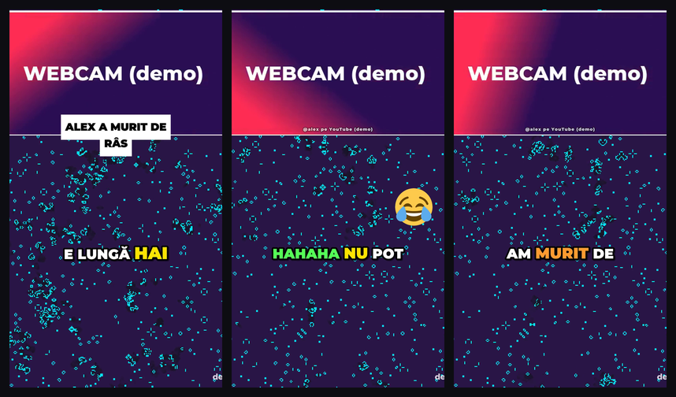

<p align="center"></p>

<h1 align="center">Stream Clipper</h1>

<p align="center">
Turns long livestreams (GTA 6 streams were the reason I built it) into short vertical clips with word-by-word captions.<br>
Windows desktop app · Romanian speech by default · runs on your own PC · free and open source (MIT)
</p>

<p align="center">
<a href="https://github.com/LucianCeusanRo/stream-clipper/actions/workflows/ci.yml"></a>
<a href="LICENSE"></a>
<a href="https://lucianceusanro.github.io/stream-clipper/">Website</a> ·
<a href="README.ro.md">Română</a> ·
<a href="https://github.com/LucianCeusanRo/stream-clipper/discussions/1">💬 Debate: clipping streamers, free promotion or taking their work?</a>
</p>

> **Unofficial fan tool, not affiliated with Rockstar Games or Take-Two.** No game footage, logos or trademarks are included in this repository.


## What it is

A program that watches a YouTube channel (or takes any video link / file), records the stream, transcribes the speech with Whisper, looks for the loud, funny or intense moments, and renders them as 9:16 clips (20–60 s) with big captions that highlight each word as it is spoken. You review every clip in a local dashboard and decide what gets posted.

Who it is for: people who make clips **for creators who want them**: a streamer's own editor, a fan page that has permission, or someone taking part in an official clipping campaign.

I'm a beginner learning programming. This was **built with AI-assisted coding**, then tested and fixed by running it. It works on my PC; it is not a polished commercial product. Issues and pull requests are welcome.

## Respect creators

Clips are someone else's work. Please:

- clip only creators who **allow it** or who run a **clipping campaign** (many streamers do, with rules and a required hashtag; that's what the `required_hashtag` setting is for);
- always **credit the creator** (the `credit_text` setting burns e.g. "@channel on YouTube" into the clip);
- follow the rules of YouTube, Twitch, Kick and TikTok, and take a clip down if the creator asks.

Auto-posting is **off** by default: nothing is posted until you press "Postează" (Post) on a clip.

## How it works

```
 YouTube live / VOD / any link / local file
          │  yt-dlp (live from the start, DVR, gap filling)
          ▼
   5-minute chunks ──► Whisper (faster-whisper, large-v3, language forced to "ro")
                              │ word timestamps
                              ▼
   moment detection: loudness spikes, screams/laughter, keywords ("nu se poate", "doamne"...),
   chat activity, optional LLM judge (any OpenAI-compatible API or local Ollama)
                              │
                              ▼
   layout: face detection (OpenCV YuNet) → webcam on top + game below, or blurred background
                              │
                              ▼
   ffmpeg render: 1080×1920, word-by-word ASS captions, hook text, emoji, zoom on peaks, −14 LUFS audio
                              │
                              ▼
   local dashboard (127.0.0.1) → you review, edit text, re-cut ±1 s → optional TikTok upload
```

| | |
|---|---|
|  |  |
| Settings: channel, streamer name, credit, campaign hashtag | Frames from a clip rendered from the synthetic demo: hook, word-by-word captions, emoji, credit |

The clip frames above come from `tools/demo.py`: a test video generated with ffmpeg (Conway's Game of Life as "gameplay", a labelled box as "webcam", beeps as "screams") and a scripted transcript. No real stream footage is used anywhere in this repo.

## Requirements

- **Windows 10/11** for the desktop app and installer (the core also runs on Linux; that's how CI tests it).
- **NVIDIA GPU with ~6 GB+ VRAM** recommended for Whisper `large-v3` (I use an RTX 4060 Ti). Without a GPU it falls back to CPU: use `whisper_model: "small"` or `"medium"`, and expect it to be much slower than real time.
- ~10 GB free disk (Whisper model ~3 GB, recordings, clips).
- Internet for YouTube. Python, ffmpeg and Deno are installed by `setup.bat` into the program folder (no admin needed).

## Install (Windows)

1. Download the code: **Code → Download ZIP** (or `git clone`), and unzip it into a simple folder such as `C:\StreamClipper`.
2. Double-click **`setup.bat`**. It installs Python 3.12 (only if you don't have it), ffmpeg, Deno, the Python packages, Chromium (for optional posting) and the Whisper model, runs the tests and creates a **"Stream Clipper"** desktop shortcut. Takes 15–20 minutes the first time.
3. It also creates **`config.yaml`** from `config.example.yaml`. Your `config.yaml`, `.env` and `data/` folder stay on your PC and are ignored by git.

## Use

1. Open **Stream Clipper** from the desktop.
2. **⚙️ Setări** (Settings; the dashboard is in Romanian for now): set the channel URL (or leave it empty), the streamer's name, the game, the credit text, and hashtags. Save.
3. Two ways to get clips:
   - **Watch a channel**: press **Start urmărire** (start watching). When the channel goes live it records from the beginning of the stream and keeps cutting clips while the stream runs.
   - **Generate from a link or file**: paste a YouTube/Twitch/Kick link (anything yt-dlp supports) or a path like `C:\Videos\stream.mp4`, optionally a from/to time and how many clips, then **✂️ Generează clipuri** (generate clips).
4. In **🆕 Clipuri noi** (new clips), watch each clip, edit the title/description, use **🔄 Refă textul** (new text) or **✂️ Refă clipul** (re-cut ±1 s, snapped to sentence edges), then **📤 Postează** (post), **⏭ Sari** (skip) or **🗑** (delete). Clip files are in `data\clips\`.
5. Optional TikTok posting: press **🔑 Login TikTok** once and log in in the Chrome window that opens. The session is stored locally in `data\tiktok_profile` (never in the repo). Posting drives the TikTok Studio website like a person clicking; there is a gap between posts and a daily limit.

Try it without a stream or GPU: `python tools/demo.py` builds the synthetic test video, renders clips from it and opens the dashboard at http://127.0.0.1:8833.

### Optional: LLM for better moment picking and titles

Copy `.env.example` to `.env` and fill in **one** provider (OpenAI, xAI, Groq, OpenRouter) or point it at a local [Ollama](https://ollama.com) model for free. Without an LLM it works on rules and title templates. Never commit your `.env`.

## Main settings (`config.yaml` or the Settings tab)

| setting | default | what it does |
|---|---|---|
| `channel_url` | empty | YouTube channel to watch; empty = only manual links/files |
| `streamer_name`, `game` | empty, `GTA 6` | used in hooks and titles |
| `credit_text` | empty | text burned into every clip, e.g. `@channel on YouTube` |
| `required_hashtag` | empty | campaign hashtag, always placed first when set |
| `hashtags` / `extra_hashtags` / `hashtags_max` | `#gta6` / a few popular ones / 5 | fixed + randomly picked hashtags |
| `auto_post` | `false` | `false` = you press Postează on each clip |
| `daily_post_cap`, post intervals | 30, 30–45 min | posting pace |
| `whisper_model` | `large-v3` | `small`/`medium` for weaker PCs |
| `language` | `ro` | Whisper language; the moment keywords and title templates are Romanian |
| `layout` | `split` | `split` (cam + game), `blur`, `fill` |

## Limitations (honest)

- TikTok posting uses the website, not an official API. When TikTok changes its upload page, posting breaks until the selectors are updated. It was tested against a test page, not at scale on real TikTok.
- How much of a live stream can be fetched from the start (DVR) depends on YouTube.
- Moment detection is rule-based (volume, keywords, chat). It finds loud moments well; "funny" is harder. Review clips before posting.
- Whisper still makes mistakes with noise, music, or two people talking at once.
- Keywords, title templates and the dashboard are in Romanian. English UI is not done yet.
- The face/webcam detection is simple: a face that stays in the same place. Unusual stream layouts may need a manual `cam_box`.

## For developers

```bash
pip install -r requirements.txt
python -m streamclip selftest --quick   # unit + render tests in a temp folder (needs ffmpeg)
python -m streamclip run                # dashboard at http://127.0.0.1:8777 without the desktop window
```

Code map: `app.py` (24/7 orchestration), `youtube.py` (live/DVR/VOD/chat), `recorder.py`, `transcribe.py`, `detect.py`, `viral.py`, `llm.py`, `layout.py` + `facecam.py`, `render.py` + `effects.py`, `jobs.py` (manual links), `tiktok.py`, `web.py` + `web/index.html`, `db.py` (SQLite state, so nothing is cut or posted twice after a restart).

CI (GitHub Actions) runs the tests on Ubuntu with ffmpeg; the Whisper/GPU parts are not exercised in CI.

## Credits

Libraries, fonts, emoji and the ideas I learned from are listed in [THIRD_PARTY.md](THIRD_PARTY.md).

## License

[MIT](LICENSE) © 2026 Lucian-Ciprian Ceușan
