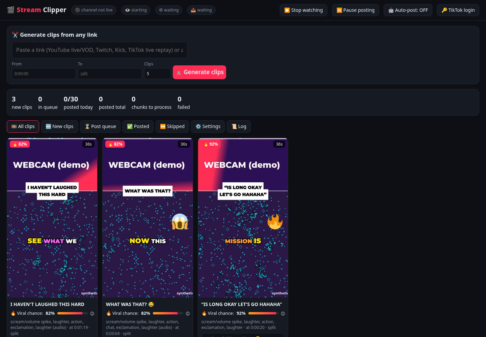

# Stream Clipper (română)

Face din live-uri lungi clipuri verticale scurte, cu subtitrare cuvânt-cu-cuvânt. Merge pentru orice streamer și orice limbă pe care o știe Whisper (gaming, IRL, podcast); l-am făcut pentru live-urile de GTA 6.
Aplicație Windows, rulează pe PC-ul tău, gratuită și open source (MIT). [English README](README.md) · [💬 Dezbatere: clipurile cu streameri sunt promovare gratuită sau luare din munca lor?](https://github.com/LucianCeusanRo/stream-clipper/discussions/1)

> **Unealtă neoficială de fan, fără legătură cu Rockstar Games sau Take-Two.** Repo-ul nu conține imagini din joc, logo-uri sau mărci.

## Ce face

Urmărește un canal de YouTube (sau primește orice link / fișier), înregistrează live-ul, transcrie româna cu Whisper, caută momentele cu râs, țipete, nervi sau reacții tari și le face clipuri 9:16 (20–60 s) cu subtitrări mari. Tu vezi fiecare clip în aplicație și decizi ce se postează.

Sunt începător și învăț programare. Proiectul e **făcut cu ajutorul AI la cod**, apoi testat și reparat rulându-l. Merge pe PC-ul meu; nu e un produs comercial finisat.

## Respectă creatorii

- clipuiește doar creatori care **permit** asta sau au o **campanie de clipping** (setarea `required_hashtag` e pentru hashtag-ul cerut de campanie);
- dă **mereu credit** creatorului (setarea `credit_text` pune pe clip, de ex., „@canal pe YouTube”);
- respectă regulile YouTube, Twitch, Kick și TikTok și șterge clipul dacă îți cere creatorul.

Auto-postarea e **oprită** implicit: nu se postează nimic până nu apeși „Postează”.

## Ce îți trebuie

- Windows 10/11; placă NVIDIA cu ~6 GB+ VRAM pentru Whisper `large-v3` (eu folosesc RTX 4060 Ti). Fără placă merge pe procesor cu `small`/`medium`, dar mult mai încet.
- ~10 GB liberi pe disc, internet.

## Instalare

1. **Code → Download ZIP**, dezarhivează într-un folder simplu, ex. `C:\StreamClipper`.
2. Dublu-click pe **`setup.bat`** (instalează Python 3.12 dacă lipsește, ffmpeg, Deno, pachetele, modelul Whisper, rulează testele, face scurtătura „Stream Clipper” pe Desktop; 15–20 min prima dată). Creează și `config.yaml` din `config.example.yaml`.
3. Pentru română: în `config.yaml` pune `language: "ro"` și `ui_language: "ro"` (sau din aplicație: Settings → Speech language / Interface language).
4. Deschide **Stream Clipper** → **⚙️ Setări**: canalul (sau gol), numele streamerului, jocul, textul de credit, hashtag-urile → **💾 Salvează**.
5. **▶ Start urmărire** pentru canal, sau lipește un link / fișier sus și apasă **✂️ Generează clipuri**.
6. În **🆕 Clipuri noi**: vezi clipul, editezi textul, **🔄 Refă textul**, **✂️ Refă clipul**, apoi **📤 Postează / ⏭ Sari / 🗑**.

Fără live și fără placă video: `python tools/demo.py` face un video de test cu ffmpeg, taie clipuri din el și deschide aplicația la http://127.0.0.1:8833.

Opțional, un LLM (OpenAI, xAI, Groq, OpenRouter sau Ollama local, gratuit) alege mai bine momentele și titlurile: copiază `.env.example` ca `.env`. Nu urca niciodată `.env` pe GitHub.

## Limitări (sincer)

- Postarea pe TikTok merge prin site, nu prin API oficial; când TikTok schimbă pagina, poate pica până la o actualizare.
- Detecția e pe reguli (volum, cuvinte, chat): găsește bine momentele tari, „amuzant” e mai greu. Verifică clipurile înainte să postezi.
- Whisper mai greșește cu zgomot, muzică sau doi oameni care vorbesc deodată.
- Unele mesaje de stare și log-ul sunt încă doar în română.

Detalii tehnice, setări și structura codului: [README.md](README.md). Licență [MIT](LICENSE).
